# Best Sensor Positioning Based on Improved Greedy Algorithm (Matlab Code Implementation)

1. Overview
In many cases, measuring physical phenomena that change with space and time is meaningful. Common examples include temperature, sound, and pollution. The modern approach to solving this problem often relies on Wireless Sensor Networks (WSN), which are systems composed of numerous sensor nodes, each capable of measuring, processing, and communicating information about the surrounding environment. Challenges and trade-offs are characteristic of WSN design. One key aspect of designing a successful WSN is optimizing the spatial position of sensor nodes, considering the impact of location on many relevant metrics such as coverage range, energy consumption, and connectivity. When data collected by the WSN is used to solve inverse problems, the optimization of sensor positions becomes even more critical.
Accepting suboptimal sensor placements produced by approximate algorithms can significantly reduce computational costs. In this case, it is necessary to have an algorithm close to optimal, as they always produce quality solutions. We refer to this quality measure as the approximation factor, which is the ratio between the value of the approximate solution and the optimal solution.
A classic problem is to estimate a set of parameters from measurements collected by only a few sensors. The number of sensors is usually constrained by physical or economic constraints, and their positions are crucial for obtaining accurate estimates. Unfortunately, the selection of optimal sensor locations is essentially combinatorial, and it cannot guarantee that available approximate algorithms will produce good solutions in all cases of interest. We propose FrameSense, an algorithmic approach for selecting optimal sensor locations. The core cost function of this algorithm is frame potential, which measures the scalar property of a matrix, its orthogonality with respect to its rows.It is noteworthy that FrameSense is the first algorithm to approach optimality in terms of mean square error, meaning its solutions always guarantee an optimal solution. Additionally, through extensive numerical experiments, we have shown that compared to other greedy methods, FrameSense achieves state-of-the-art performance while maintaining the lowest computational costs.
Editor's Note: The detailed mathematical models and their explanations are presented in Section 4.
3 Case Studies and Simulation Implementation
3.1 Algorithm Comparison
We compare the performance of FrameSense with other greedy algorithms that use common cost functions. We generate random matrices and test different greedy algorithms for varying numbers of sensor placements. Performance is measured by Mean Squared Error (MSE), hence the lower the curve, the better the performance. The shadow areas represent the positive side of error lines, using standard deviation measurements exceeding 100 implementations. We considered four different types of sensor matrices and found that FrameSense consistently outperformed all other algorithms across all cases. We emphasized the consistency of FrameSense on four different types of matrices.
matrix_type=3;\n\n%% Image Title\nswitch matrix_type\n    case 0\n        Psi=randn(N,K);\n        \n        tit2='Gaussian serial matrix with normalized rows';\n        fn='rnd_gauss_norm';\n    case 1\n        tit2='Gaussian random matrix';\n        fn='rnd_gauss';\n    case 2\n        \n        tit2='Random secondary sampling DCT Matrix';\n        fn='rnd_DCT_matrix';\n    case 3\n        tit2='Random Framework';\n        fn='rnd_tight_frame';\n    case 4\n        tit2='Bernoulli stochastic matrix';\n        fn='rnd_bernoulli';\n        \nend\n\n%% Download data DATA\nload(['./data/',fn,'.mat'])\n\n\n%% Visualize MSE\n\n%%\ngcf=figure(1);\nset(gcf,'Color',[1 1 1]);\nhold on\nh(1)=perc_plot( 10*log10(MSE_FP(2:end,:)'),L(2:end),1)\nh(2)=perc_plot( 10*log10(MSE_det(2:end,:)'),L(2:end),7)\nh(3)=perc_plot( 10*log10(MSE_mutual_inf(2:end,:)'),L(2:end),5)\nh(4)=perc_plot( 10*log10(MSE_MSE(2:end,:)'),L(2:end),3)\nh(5)=perc_plot( 10*log10(MSE_rnd(2:end,:)'),L(2:end),2)\nif matrix_type==4\naxis([L(2),L(end),35,75])\nend\nhLegend=legend(h,'FrameSense','Determinant','Mutual Information','MSE','Random')\n\nlegend('boxoff')\n\nhTitle  = title (tit2);\nhXLabel = xlabel('Number of sensors'                     );\nhYLabel = ylabel('Standardization MSE [dB]'                      );\n\nset( gca                       , ...\n    'FontName'   , 'Helvetica' );\nset([hTitle, hXLabel, hYLabel], ...\n    'FontName'   , 'Helvetica');\nset([hLegend, gca]             , ...\n    'FontSize'   , 14           );\nset([hXLabel, hYLabel]  , ...\n    'FontSize'   , 14          );\nset( hTitle                    , ...\n    'FontSize'   , 16          );\npbaspect([16,9, 14])\n  
Editor
Editor
Editor
3.2 Comparison of computation times Computation time is used as a measure of the function between greedy algorithms and other cost functions commonly considered in FrameSense. The lower the curve, the faster the algorithm. Note that FrameSense is the fastest algorithm, except for random selection. Additionally, observe how different algorithms are equivalently extended. Error bars are not shown because they are less than the markers.
Editor
3.3 Balance between computation time and MSE Sensors. Performance is measured by MSE. Therefore, the lower the dot, The higher the performance, the better. On the other hand, The calculation time is in seconds. The error line is represented as an ellipse. The length of the axis represents the standard deviation of the data points. Please note. FrameSense is a fast algorithm on the order of magnitude. And it's the second-best algorithm in terms of MSE. When the legend mentions the cost function, We consider a simple greedy algorithm to optimize this cost function. On the other hand, We consulted the authors on implementing complex solutions and/or heuristic-specific algorithms.
Editor
Editor
Editor
matrix_type=2;\n%% Title\nswitch matrix_type\n    case 0\n        \n        tit2='Normalized Gaussian matrix';\n        fn='rnd_gauss_norm';\n    case 1\n        tit2='Gaussian random matrix';\n        fn='rnd_gauss';\n    case 2\n        \n        tit2='Random secondary sampling DCT Matrix';\n        fn='rnd_DCT_matrix';\n    case 3\n        tit2='Random Framework';\n        fn='rnd_tight_frame';\n    case 5\n        load Psi_tmaps_red.mat;\n    case 4\n        tit2='Bernoulli stochastic matrix';\n        fn='rnd_bernoulli';\n        \nend\n\n%% Load DATA\nload(['./data/',fn,'.mat'])\n\n\n%% Plot MSE\nind=3;\ngcf=figure(1);\nset(gcf,'Color',[1 1 1]);\nhold on\nh(1)=perc_scatter( log10(time_FP(ind,:)'), 10*log10(MSE_FP(ind,:)'),1);\nh(2)=perc_scatter( log10(time_det(ind,:)'), 10*log10(MSE_det(ind,:)'),7);\nh(3)=perc_scatter( log10(time_mutual_inf(ind,:)'), 10*log10(MSE_mutual_inf(ind,:)'),5);\nh(4)=perc_scatter( log10(time_MSE(ind,:)'), 10*log10(MSE_MSE(ind,:)'),3);\nh(5)=perc_scatter( log10(time_rnd(ind,:)'), 10*log10(MSE_rnd(ind,:)'),2);\nh(6)=perc_scatter( log10(time_joshi(ind,:)'), 10*log10(MSE_joshi(ind,:)'),13);\n\n%%\nhLegend=legend(h,'FrameSense','Determinant','Mutual Information','MSE','Random','Convex Opt. Method [6]')\n\nswitch matrix_type\n    case 4\n        axis([-5,1,35,65])\n        set(hLegend,'Location','NorthWest');\n    case 1\n        axis([-5,1,-0,6])\n        set(hLegend,'Location','SouthWest');\n    case 3\n        set(hLegend,'Location','NorthWest');\n        \n    case 0\n        set(hLegend,'Location','NorthWest')\n    \n    case 2\n        axis([-5,5,10,40])\n        %set(hLegend,'Location','SouthWest');\nend\n%%\n\nlegend('boxoff')\n\nhTitle  = title (tit2);\nhXLabel = xlabel('Calculation time [log s]'                     );\nhYLabel = ylabel('Standardization MSE [dB]'                      );\n\nset( gca                       , ...\n    'FontName'   , 'Helvetica' );\nset([hTitle, hXLabel, hYLabel], ...\n    'FontName'   , 'Helvetica');\nset([hLegend, gca]             , ...\n    'FontSize'   , 14           );\nset([hXLabel, hYLabel]  , ...\n    'FontSize'   , 14          );\nset( hTitle                    , ...\n    'FontSize'   , 16          );\npbaspect([16,9, 14])\n  
3.4 Balance Analysis between FrameSense and Convex Shrinkage Algorithms in terms of Computation Time and MSE We generate 100 Gaussian matrices with increasing sizes. Place the sensors simultaneously. The error line is represented as an ellipse. The length of the axis represents the standard deviation of the data points. We measured the average computation time and average MSE. Although FrameSense is significantly faster than the convex algorithm, However, the differences in MSE are very small. Furthermore, As the scale of problems expands, The gap in solution quality will narrow.
Editor
3.5 FrameSense Compared with other greedy algorithms and consistency-based greedy algorithms in this experiment, We consider the placement of sensors to estimate temperature for an 8-core microprocessor using a limited number of sensors. Two different matrices are proposed: on the left side. The matrix is generated from the principal component analysis of the known heatmap. As shown in [31]; The matrix on the right is the quadratic sampling DCT matrix proposed in [32]. The shadow area indicates the positive side of the random sensor placement error bar. Standard deviation measurement using more than 100 instances. Please note. FrameSense is clearly superior to previous methods based on coherence and other greedy algorithms. Especially when the number of sensors is close to the number of estimated parameters. That is
Editor
Editor
4. Matlab Code and Article Reading
Editor
clear all;\nclose all;\n\n%% Visualization\naddpath('./export_fig/')\n\n\nload('./data/tmaps_DCT_comp')\n\n%%\ngcf=figure(1);\nset(gcf,'Color',[1 1 1]);\nhold on\nh(1)=perc_plot( 10*log10(MSE_FP'),L,1)\nh(2)=perc_plot( 10*log10(MSE_det),L,7)\nh(3)=perc_plot( 10*log10(MSE_mutual_inf),L,5)\nh(4)=perc_plot( 10*log10(MSE_MSE'),L,3)\n    h(5)=perc_plot( 10*log10(MSE_rnd'),L,2)\nh(6)=perc_plot( 10*log10(MSE_cohe'),L,4)\nhold off\nhLegend=legend(h,'FrameSense','Determinant','Mutual Information','MSE','Random','Coherence')\naxx=axis;\naxis([L(1),L(end),20,120]);\nlegend('boxoff')\n\nhTitle  = title ('With DCT Sensor placement for thermal maps');\nhXLabel = xlabel('Number of sensors'                     );\nhYLabel = ylabel('MSE [dB]'                      );\n\nset( gca                       , ...\n    'FontName'   , 'Helvetica' );\nset([hTitle, hXLabel, hYLabel], ...\n    'FontName'   , 'Helvetica');\nset([hLegend, gca]             , ...\n    'FontSize'   , 14           );\nset([hXLabel, hYLabel]  , ...\n    'FontSize'   , 14          );\nset( hTitle                    , ...\n    'FontSize'   , 16);\npbaspect([16,9, 14])\n  
5. Endnotes: The references to theoretical literature are from online sources, and if any infringement occurs, please contact the blogger for removal.

## Images

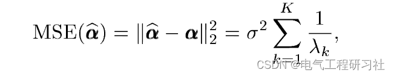
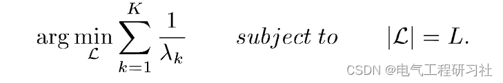
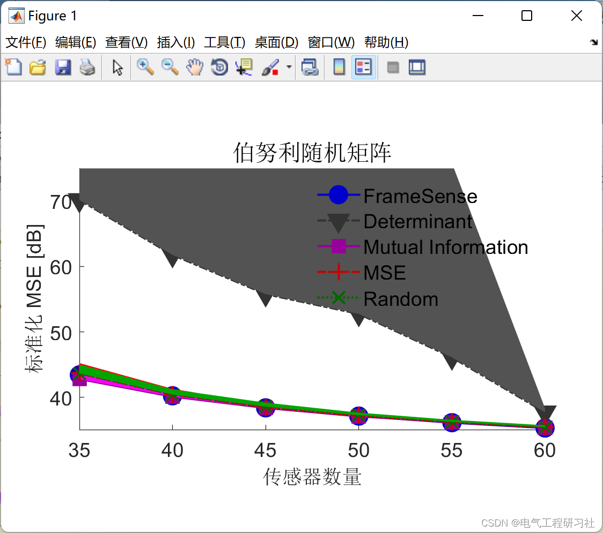
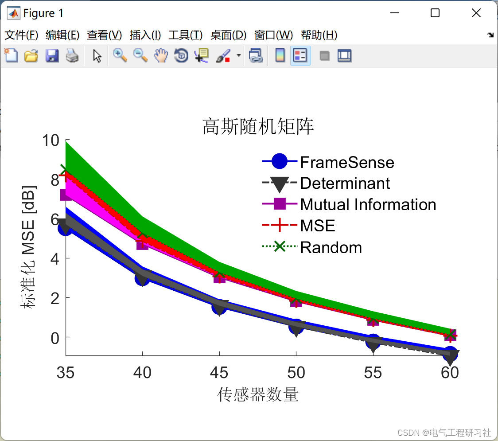
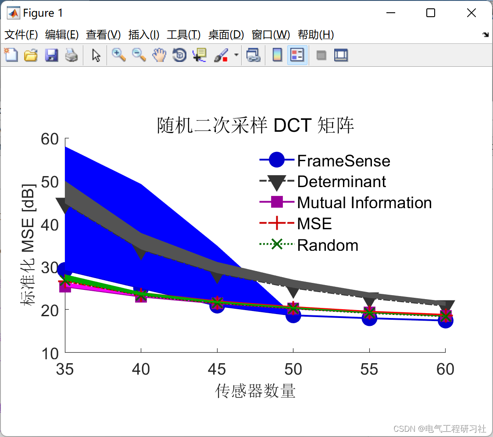
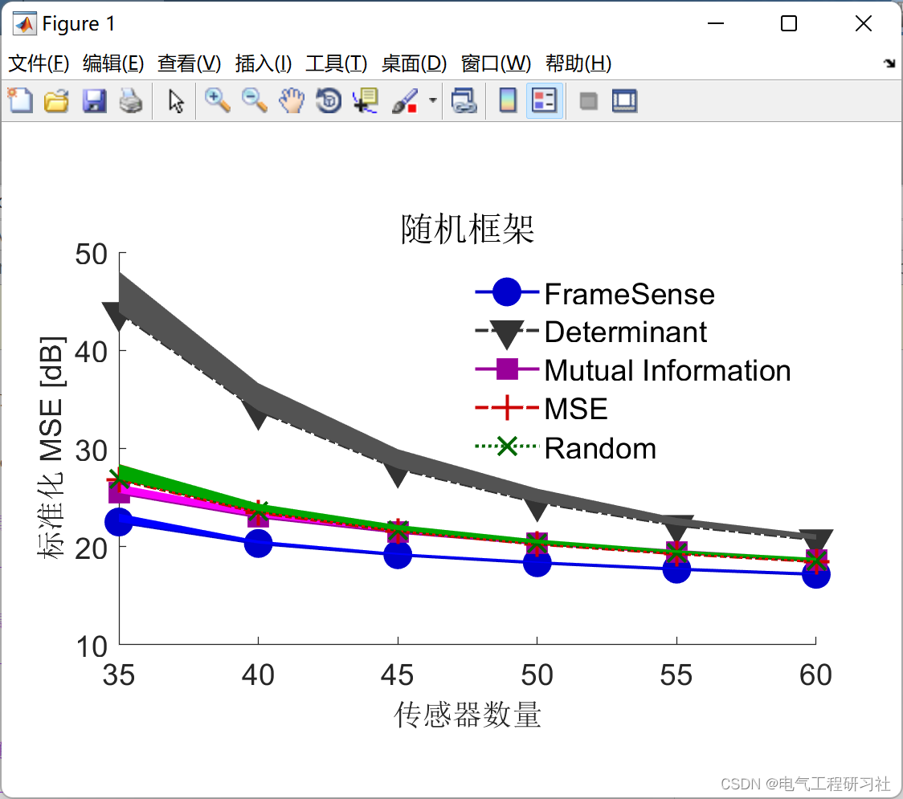
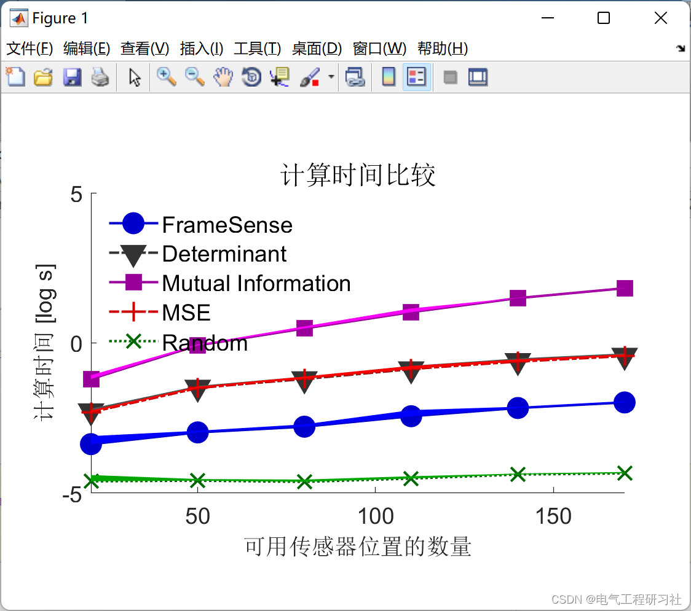
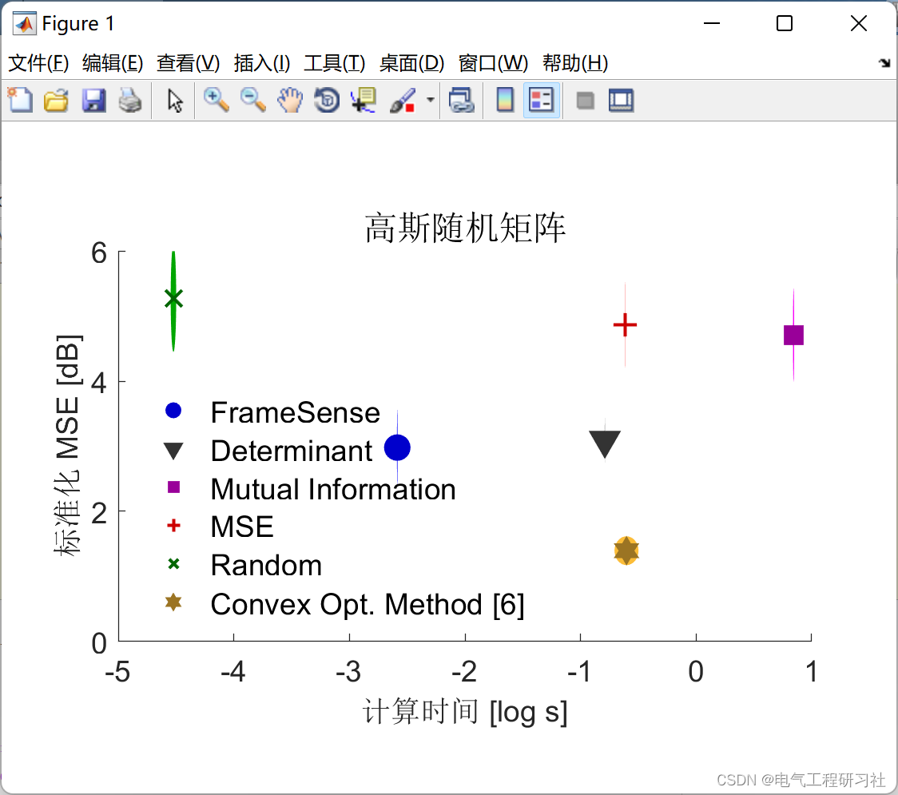
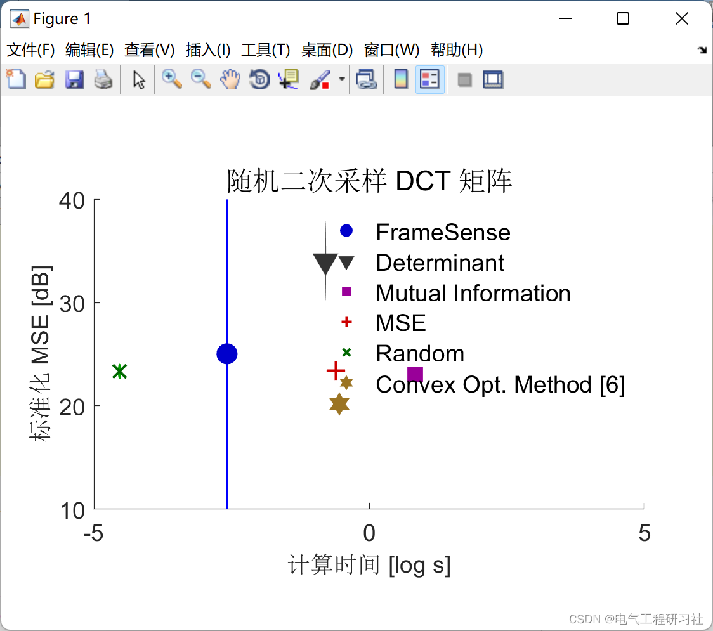
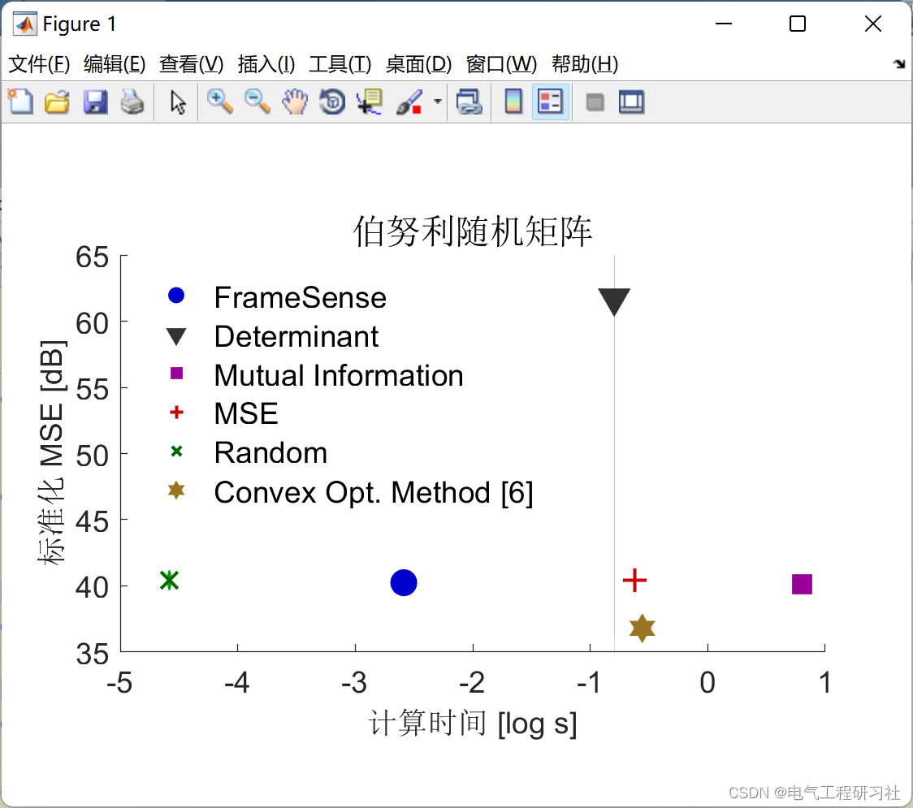
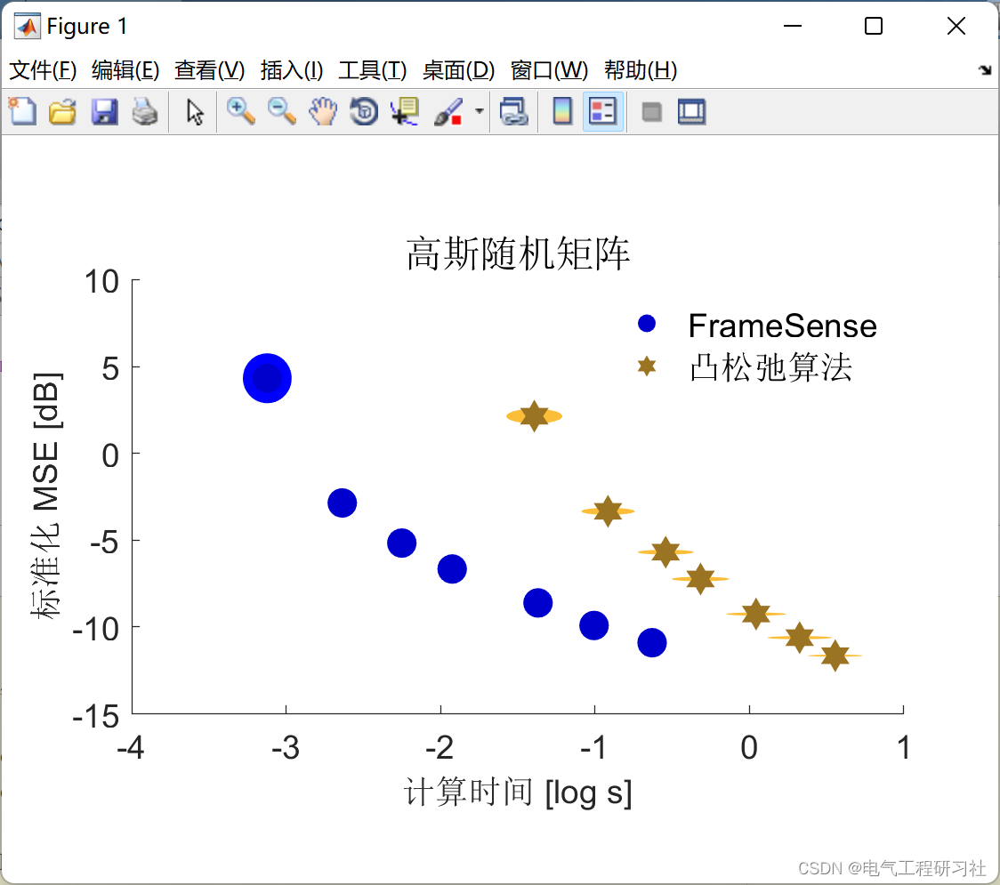
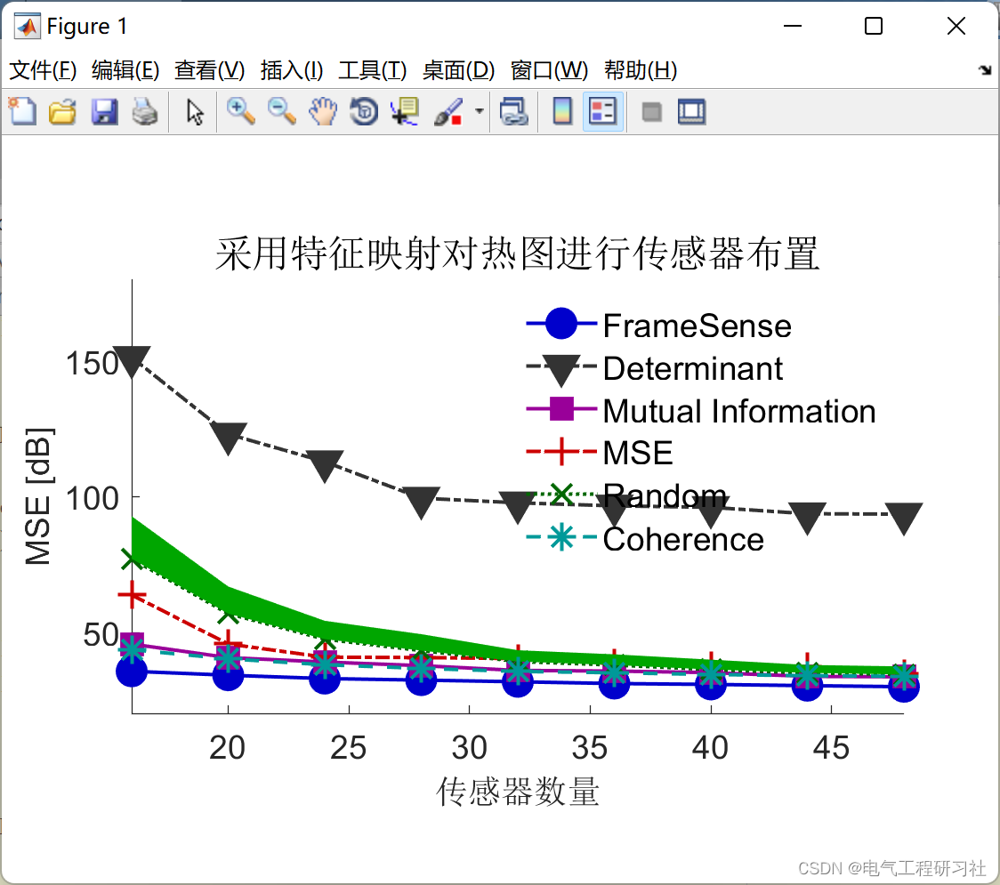
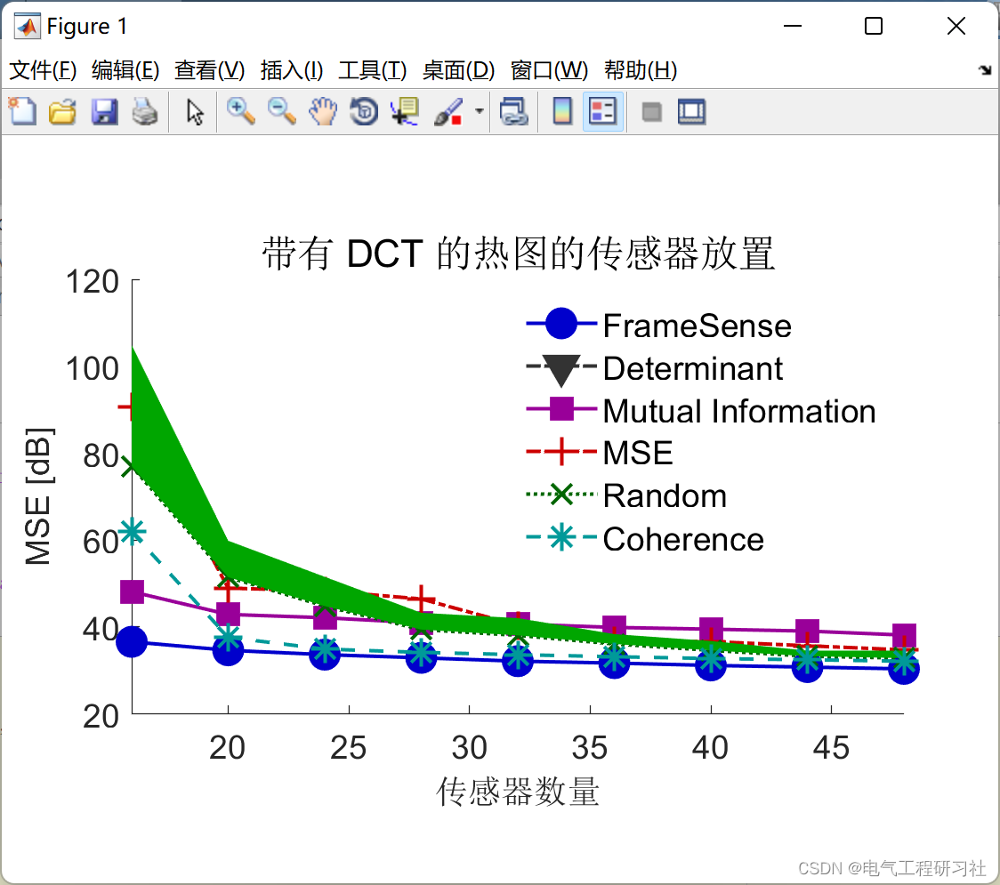
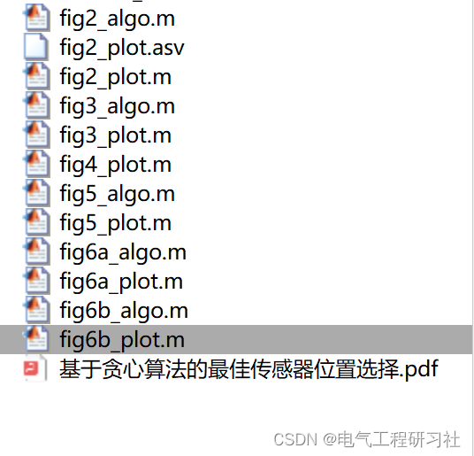

<!-- PAYMENT_BLOCK -->

## Get this dataset

- Payment link (Stripe): [Buy now](https://buy.stripe.com/3cs8yP7sY87d0vu9AB)
- Payment QR code: 

<!-- /PAYMENT_BLOCK -->
